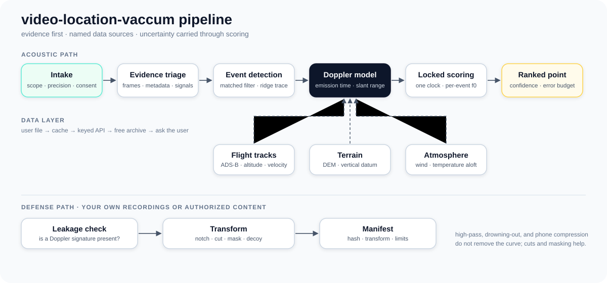
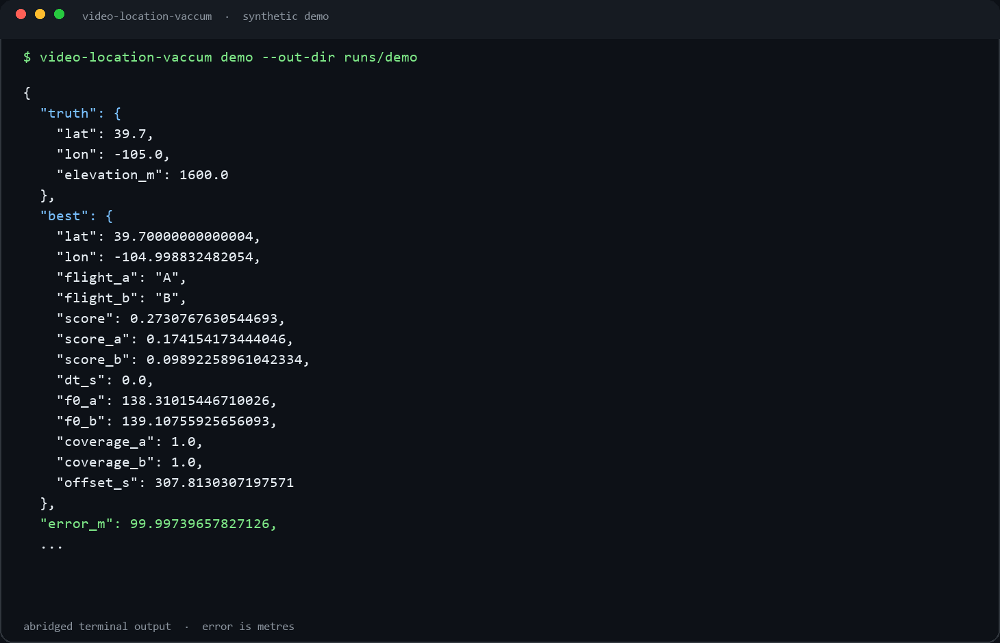
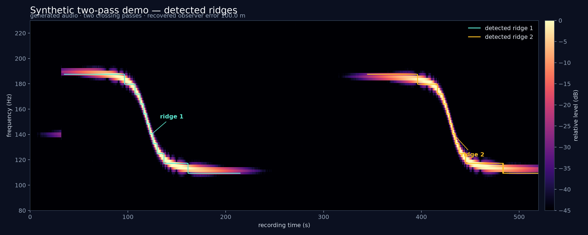
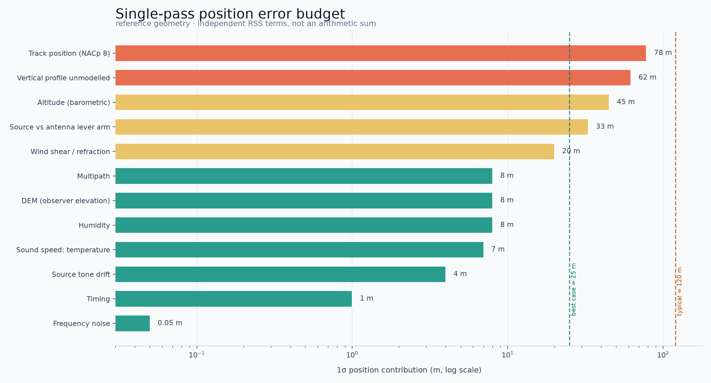

# video-location-vaccum

**Evidence-first geolocation from aircraft Doppler signatures in ordinary audio.**

`video-location-vaccum` is a Python library and command-line tool that turns a recording
containing a faint aircraft pass into a ranked, uncertainty-quantified location
estimate — or says honestly that the evidence does not support one.

> **Status: 0.1.0 alpha.** The core method works end to end and is covered by
> synthetic ground-truth tests. It is **not** production-ready for operational,
> legal, or safety-critical use. Accuracy is bounded by flight-track quality,
> atmospheric modelling, and source-tone stability. Read
> [docs/PRECISION.md](docs/PRECISION.md) before relying on a result.

<p align="center">
  
</p>

## Why this exists

Aircraft engines and propellers leave narrow, falling frequency tracks in audio.
Because the Doppler shift depends on the aircraft's velocity and distance, a
measurable track can constrain where the microphone was. Two passes usually
remove the mirror ambiguity; a single pass needs a known recording time or a
spatial prior.

The project is built around three rules:

1. **Triage before analysis.** Visual, textual, and metadata evidence may settle
   the question before any acoustics are needed.
2. **Never invent data.** Flight, terrain, weather, and imagery data come from a
   named source with a timestamp and licence, or the result is marked incomplete.
3. **Report uncertainty.** A ranked point without its assumptions, error budget,
   and sensitivity is not a result.

## What it does

- **Mandatory intake** — goal, required precision, date, time, region, visible
  clues, audio history, permission, harm, network policy, and data availability.
- **Evidence triage** — frames, transcript, metadata, mains hum, tonality, and
  reverb. Acoustic analysis is skipped only when visual evidence clears the
  requested precision at high confidence.
- **Automatic and guided event detection** — a matched-filter detector finds
  flyovers; a guided tracer handles weak or overlapping ridges.
- **Physical modelling** — retarded-time radial velocity, slant distance,
  delayed CPA, one shared clock offset, per-event `f0`, and robust scoring.
- **Real data fallbacks** — user file → cache → keyed API → free archive → ask.
  Historical dates never silently fall back to live data.
- **Defence mode** — detect a Doppler leak, notch the ridge, cut the time offset,
  mask with shaped noise, or add decoy curves, with a transformation manifest.
- **Audio-only support** — no video stream is required.

## Install

```bash
git clone https://github.com/tanish14bot/video-location-vaccum.git
cd video-location-vaccum
python -m pip install -e ".[audio,geo,parquet]"
video-location-vaccum doctor
```

Requirements: Python 3.10+ and `ffmpeg`/`ffprobe`. Optional extras:
`soundfile`, `pyarrow`, `rasterio`, `mutagen`, and external evidence tools.

## Quick start

```bash
# 0. Answer the pre-analysis questions.
video-location-vaccum intake

# 1. Extract evidence and write the worksheet.
video-location-vaccum triage --video clip.mp4 --out-dir runs/case \
  --question "Where was this filmed?"

# 2. Fill evidence.json, then apply the rubric.
video-location-vaccum decide --evidence runs/case/evidence.json

# 3. Detect flyovers automatically (or use `trace` for a manual ridge).
video-location-vaccum auto --audio clip.mp4 --out runs/auto

# 4. Measure or refine events, then search.
video-location-vaccum events --config runs/case/config.yaml --out-dir runs/case
video-location-vaccum run --config runs/case/config.yaml
```

If detection is ambiguous, trace one visible ridge at a time:

```bash
video-location-vaccum trace --audio clip.wav --t0 2150 --t1 2230 \
  --f-start 190 --f-end 100 --out runs/trace
```

No media or flight data? Run the synthetic end-to-end validation:

```bash
video-location-vaccum demo
```

The demo contains a known observer, crossing passes, and generated audio. The
detected path recovers the truth to roughly 100 m; supplying truth events
tightens it to roughly 50 m.

## Visual tour

The synthetic demo output, abridged — the recovered observer error is **100 m**:

<p align="center">
  
</p>

The same demo's two detected ridges, overlaid on the generated spectrogram:

<p align="center">
  
</p>

## Commands

| Command | Purpose |
|---|---|
| `doctor` | Check Python, ffmpeg, optional libraries, and data access |
| `intake` | Print the mandatory questionnaire |
| `triage` | Extract frames, transcript, metadata, and signal clues |
| `decide` | Apply the evidence rubric and decide whether to run acoustics |
| `auto` | Detect flyovers with the matched-filter detector |
| `events` | Measure or merge Doppler events from audio or a config |
| `trace` | Trace a single ridge and fit a flyby |
| `run` | Search candidate points and rank them |
| `leakage` | Report whether a recording leaks a usable Doppler signature |
| `defend` | Remove, mask, or spoof a Doppler signature |
| `demo` | Run the synthetic ground-truth test |

Use `video-location-vaccum <command> --help` for the full option set.

## How it works

1. **Measure** the curve: frequency depth gives a velocity band; curve rate
   gives a CPA slant-range band; `f0` and the heard CPA time anchor the event.
2. **Filter by time**: compute each flight's CPA, convert it to a delayed CPA
   using slant distance and terrain elevation, and keep points whose event
   offsets match the measured offset.
3. **Filter by geometry and silence**: apply velocity/range bands and require
   the quiet interval to stay quiet.
4. **Model**: rebuild each candidate's curve using emission-time radial velocity
   and the Doppler equation.
5. **Score**: compare predicted curves with spectrogram brightness using one
   shared clock offset, then refine the surviving grid cells.
6. **Confirm**: inspect score maps, compare with imagery or metadata, and label
   the result as confirmed, consistent-unconfirmed, or contradicted.

## Precision

Single-pass geolocation is a ranking problem, not a GPS fix. Typical
single-pass precision is tens to hundreds of metres; a second pass or a known
recording time is what usually makes a point decisive.

The dominant error sources are:

- source-frequency stability,
- aircraft altitude and track accuracy,
- atmospheric temperature and wind profiles,
- multipath and source directivity,
- grid resolution and score-surface flatness.



The full error budget and the meaning of “military grade” are in
[docs/PRECISION.md](docs/PRECISION.md).

## Defence and privacy

The same physics can be used to check whether your own recording leaks a
location. The defence module measures leakage and applies a chosen transform:

```bash
video-location-vaccum leakage --audio clip.wav --out-dir runs/leak

video-location-vaccum defend --audio clip.wav --out sanitized.wav \
  --mode notch --width-hz 25
video-location-vaccum defend --audio clip.wav --out cut.wav --mode cut
video-location-vaccum defend --audio clip.wav --out masked.wav --mode mask --snr-db 12
video-location-vaccum defend --audio clip.wav --out decoy.wav \
  --mode decoy --decoys 2 --i-understand
```

On the synthetic fixture, a 25 Hz notch reduced a detected event at 51.6 dB to
no event. Masking and cutting also reduce detectability; high-pass filtering and
phone compression do not remove the signature. Decoys are counter-forensic and
require explicit acknowledgement. See [docs/DEFENSE.md](docs/DEFENSE.md).

## Data and licensing

No media, flight tracks, terrain tiles, or imagery are bundled. The pipeline
works with user-supplied files, local caches, and public sources such as
OpenSky, adsb.lol archives, USGS/Copernicus terrain, and optional paid ADS-B
providers. Every adapter declares its access method and licence; see
[docs/DATA_SOURCES.md](docs/DATA_SOURCES.md).

The project is released under a custom research-only licence. Third-party
software and data licences are recorded in [NOTICE](NOTICE) and
[docs/PRIOR_ART.md](docs/PRIOR_ART.md).

## Scope and limits

- Requires a measurable Doppler curve. Music beds, aggressive denoising, and
  lossy phone processing can destroy it.
- Requires flight data for the date and region. Free historical coverage is
  incomplete before 2023.
- A single pass gives a distance and a mirror pair, not a unique point.
- Region-scale searches are supported; continent-scale chunking is not
  implemented.
- Not a substitute for lawful process, consent, or professional verification.

## Documentation

- [Architecture](docs/ARCHITECTURE.md) — modules, time bases, datum, determinism.
- [Precision limits](docs/PRECISION.md) — error budget and honest accuracy.
- [Triage](docs/TRIAGE.md) — rubric, gates, and overrides.
- [Signals](docs/SIGNALS.md) — metadata, acoustic, aircraft, and visual clues.
- [Defense](docs/DEFENSE.md) — removal, masking, decoys, and limits.
- [Roadmap](docs/ROADMAP.md) — phases, acceptance criteria, and backlog.
- [Prior art](docs/PRIOR_ART.md) — related implementations, validation, licences.
- [Data sources](docs/DATA_SOURCES.md) — providers, licences, fallback chain.
- [Release checklist](docs/RELEASE_CHECKLIST.md) — pre-publish gates.
- [Ethics](ETHICS.md) — acceptable use and harm triage.
- [Security](SECURITY.md) — threat model and reporting.

## Development

```bash
python -m pip install -e ".[dev,audio,geo,parquet]"
pytest -q
ruff check src tests
ruff format --check src tests
mypy src/video_location_vaccum
```

The test suite includes fast unit tests and slower end-to-end fixtures. The
current gate is the full suite plus a clean build and package check.

## License

**Research-only.** Free for non-commercial academic, scholarly, teaching,
personal-study, and evaluation use. Commercial or operational use requires prior
written permission. See [LICENSE](LICENSE) for the full terms.

Third-party components retain their own licences; see [NOTICE](NOTICE). This
project is not an OSI-approved open-source project.
